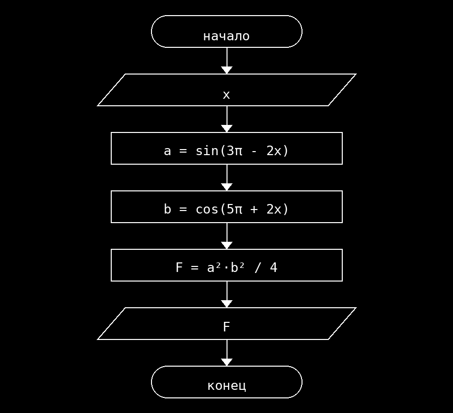

**Условие**
Вычислить значение F = (a² · b²) / 4, где a = sin(3π − 2x), b = cos(5π + 2x). Значение x вводится с клавиатуры.

**Блок схема**

**Контрольный пример**
Ввод: 0
Вывод: 0.000000

Ввод: 1
Вывод: 0.035797

Ввод: 2
Вывод: 0.061177
